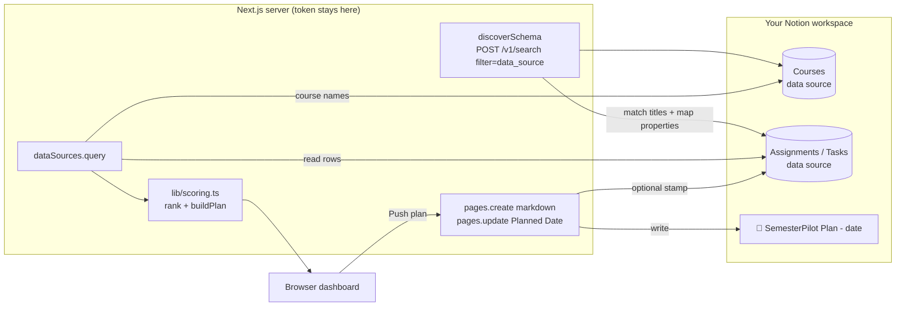

# SemesterPilot

**Your Notion Student OS, turned into a realistic plan for today.**

SemesterPilot reads the Courses and Assignments databases in your Notion Student OS, scores every open assignment by urgency, grade weight and remaining effort, and gives you a time-boxed study plan for the hours you actually have. Then it writes that plan back into Notion.

## 1. What it does and the problem it solves

Students keep deadlines in Notion, spread across databases, templates and views. Notion tells you *what* is due. It doesn't tell you **what to do today, or for how long**. So you either re-sort lists every evening or you work on whatever feels loudest.

SemesterPilot answers that question:

- **Today's plan.** Time-boxed study blocks (≤ 60 min, with 10-minute breaks) that fit your available time. The default is 3 hours, and a slider changes it.
- **Overdue and due-soon lists** so nothing slips.
- **7-day workload heat strip** that shows which days are about to get heavy.
- **Explain my plan.** Every item shows its score breakdown and why it got time today (or didn't).
- **Push plan to Notion.** Creates a `SemesterPilot Plan - <date>` page from markdown and links to it. If your assignments have a *Planned Date* property, it also stamps today's date on the scheduled items.
- **AI study coach (optional, OpenAI).** One click gives a short briefing for the day, a concrete first step for every block, and a "watch out" note for the week. The steps show up inside the schedule and are included in the Notion plan page.
- **Demo mode.** Runs with zero setup on 12 sample assignments across 4 courses.

### The priority engine (`lib/scoring.ts`)

The engine is pure and fully unit-tested:

```
score = urgency × weight × effort + overduePenalty

urgency        = 1 + 9·e^(−daysToDue / 3)     → 10 when due today/overdue, ~1 when far away
weight         = 1 + grade% / 10              → falls back to Priority (High 3 / Med 2 / Low 1.5), else 10%
effort         = √(remainingMinutes / 60)     → missing estimate defaults to 60 min
overduePenalty = min(10 + 2·daysLate, 30)
```

Scheduling (`buildPlan`) runs in rank order:

1. Items due within a day (or already overdue) get their time first.
2. Everything else gets a **fair share**: remaining work spread evenly until the due date, at least 15 min.
3. Leftover time goes to finishing the top-ranked items.
4. **No course can take more than 60% of the day.**

### AI study coach (`lib/coach.ts`)

The ranking and schedule are always computed by the deterministic engine above. The model never reorders or adds items, it only explains and coaches. `POST /api/coach` rebuilds the plan on the server and sends OpenAI's Responses API a compact summary: titles, course names, minutes, days to due, and the planner's reasons. It uses **Structured Outputs** (`json_schema`, `strict: true`), so the UI always gets `{ headline, briefing, steps[], watchOut }`. Steps whose IDs don't match a scheduled block are dropped. The key stays on the server. Without `OPENAI_API_KEY`, the card explains how to enable it and everything else works as before.

## 2. How I used Devin Chat

> **TEMPLATE: to be filled in by the author.** Replace the placeholders below with the real prompts and what Devin contributed.

| # | My prompt (verbatim or summarized) | What Devin did | What I changed / decided |
|---|---|---|---|
| 1 | _e.g. "Build SemesterPilot… start with the plan, then scaffold…"_ | _e.g. Scaffolded Next.js + Tailwind + vitest, wrote the plan_ | _…_ |
| 2 | _…_ | _e.g. Wrote `lib/scoring.ts` + 20 unit tests_ | _…_ |
| 3 | _…_ | _e.g. Built the mock-mode dashboard and demoed it_ | _…_ |
| 4 | _…_ | _e.g. Implemented Notion data-source discovery and write-back_ | _…_ |

**What worked well:** _…_

**Where I had to steer Devin:** _…_

**Time saved / reflections:** _…_

## 3. Notion Student OS integration

SemesterPilot only talks to Notion from **server routes**, through `@notionhq/client` with `Notion-Version: 2026-03-11`. In that API version, databases are containers for one or more **data sources**, and rows are queried through the data source endpoints.



### Discovery

1. `search` with `filter: { property: "object", value: "data_source" }` lists every data source the token can see.
2. Titles are matched against `/assignment|task|to-?do|homework|deadline/i` and `/course|class|subject|module/i`. If there are several matches, the one with the most properties wins.
3. Properties are auto-mapped by **type and name** (`lib/schema.ts`). Anything can be overridden in [`notion.config.ts`](./notion.config.ts), and you can set the databases directly with `NOTION_ASSIGNMENTS_DB_ID` / `NOTION_COURSES_DB_ID` (database ID, data source ID or URL).

### What is read and written

| Database | Property (auto-detected) | Notion types accepted | Read / Write | Why |
|---|---|---|---|---|
| Assignments | Title | `title` | Read | Block label |
| Assignments | Due date (`Due`, `Deadline`) | `date`, `formula`, `rollup` | Read | Urgency |
| Assignments | Course (`Course`, `Class`) | `relation` to Courses (preferred), `select`, `rich_text` | Read | Grouping + 60% course cap |
| Assignments | Status (`Status`, `Done`) | `status`, `select`, `checkbox` | Read | Skip finished work |
| Assignments | Priority | `select`, `status` | Read (write optional) | Weight fallback; optional rank stamp |
| Assignments | Effort (`Estimate`, `Est. Hours`, `Time`) | `number`, `formula`, `rollup` | Read | Effort factor + block length (hours auto-converted) |
| Assignments | Weight (`Weight`, `% of grade`) | `number`, `formula`, `rollup` | Read | Weight factor |
| Assignments | Planned Date (`Do Date`, `Planned`, `Scheduled`) | `date` | **Write** (if present) | Shows today's plan inside Notion views |
| Courses | Title | `title` | Read | Resolve course relation to a name |
| *(new page)* | `SemesterPilot Plan - <date>` | page via `markdown` | **Write** | Ordered plan + ranking explanation |

The plan page is created under `NOTION_PLAN_PARENT_PAGE_ID` if it's set. Otherwise it goes under the Assignments database's parent page, and failing that, into your private workspace section. Missing optional properties are skipped and reported in the UI. They never cause errors.

## 4. Run and test

### Demo mode (no Notion needed)

```bash
npm install
npm run dev
# open http://localhost:3000
```

The yellow **"Demo data"** badge confirms mock mode. Demo due dates are relative to today, so they never go stale.

### Notion mode

1. Create a personal access token at <https://www.notion.so/developers/tokens> (**New token**, then the **Notion API** capability).
2. Make sure the token can see your Courses and Assignments databases. If you use an internal integration instead, open each database and click **••• → Connections → add your integration**.
3. `cp .env.example .env.local` and set `NOTION_API_KEY=ntn_...`.
4. `npm run dev`. The badge switches to **"Live from Notion"**.
5. If the wrong database or property is picked, set the IDs in `.env.local` or the property names in `notion.config.ts`.

To force demo data while a token is set, use `USE_MOCK=true`.

### AI study coach (optional)

Add `OPENAI_API_KEY=sk-...` to `.env.local` (and optionally `OPENAI_MODEL`, default `gpt-6-luna`), restart, and click **Generate** on the *AI study coach* card. It works in both demo and Notion mode.

### Tests and checks

```bash
npm test          # vitest: scoring engine + schema mapping
npm run typecheck # tsc --noEmit (strict)
npm run lint
npm run build
```

### Deploy on Vercel

Import the repo and add `NOTION_API_KEY` and/or `OPENAI_API_KEY` (plus any optional variables) under Project → Settings → Environment Variables. Without a key, the deployment runs in demo mode.

## 5. Screenshots

> _Placeholder: add screenshots here._

| Dashboard (desktop) | Explain my plan | Mobile | Plan page in Notion |
|---|---|---|---|
| `docs/screenshot-dashboard.png` | `docs/screenshot-explain.png` | `docs/screenshot-mobile.png` | `docs/screenshot-notion.png` |

## 6. Roadmap

- [ ] Weekly plan view: run `buildPlan` across 7 days and push a week page
- [ ] Track progress: log minutes spent back into an "Effort done" property
- [ ] Calendar-aware availability (Google Calendar / Notion Calendar busy blocks)
- [ ] OAuth public integration so classmates can connect in one click
- [ ] Per-course caps and custom weights in the UI
- [ ] Exam mode: ramp up time for a selected exam over N days
- [ ] Daily scheduled push via Vercel Cron
- [ ] AI effort estimates for assignments with no estimate (suggest, then write back to Notion on approval)

## Project structure

```
app/page.tsx             server component: loads data (mock or Notion)
app/api/push/route.ts    POST: build plan, write it to Notion
app/api/coach/route.ts   POST: AI study coach (OpenAI Responses API)
components/Dashboard.tsx client UI (slider, blocks, heat strip, explain)
lib/scoring.ts           pure priority engine + planner (tested)
lib/schema.ts            pure property auto-mapping (tested)
lib/notion.ts            Notion client, discovery, read, write-back
lib/coach.ts             OpenAI structured-output coach
notion.config.ts         overrides for any Student OS variation
data/sample.json         demo data
```
